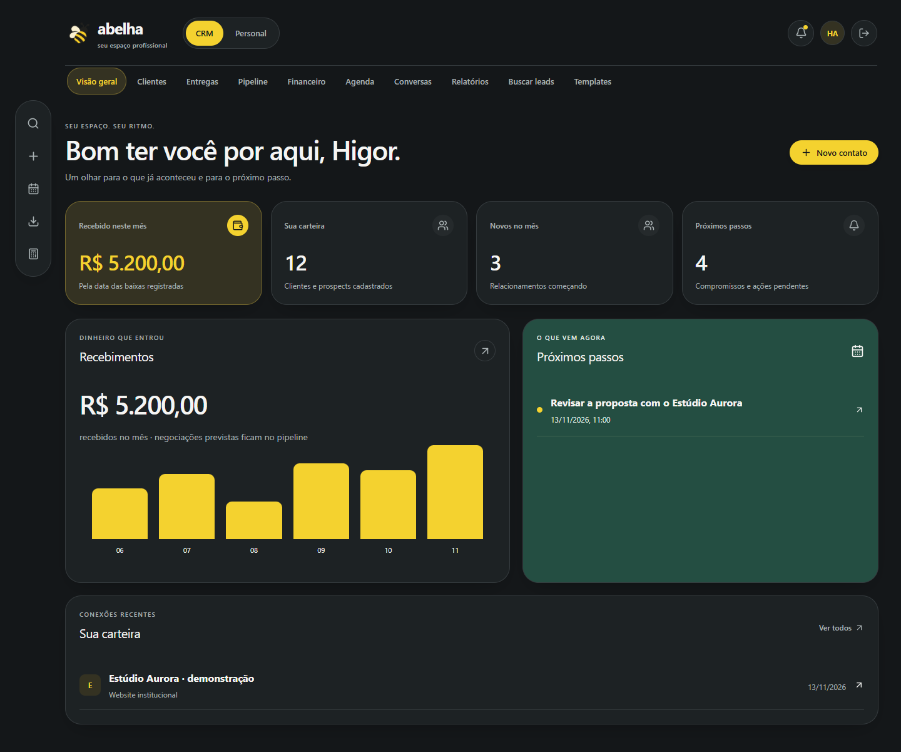
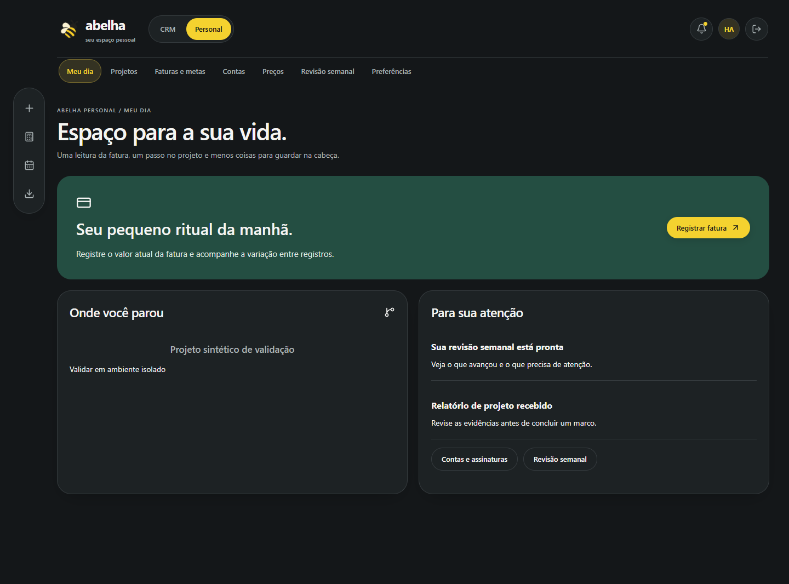
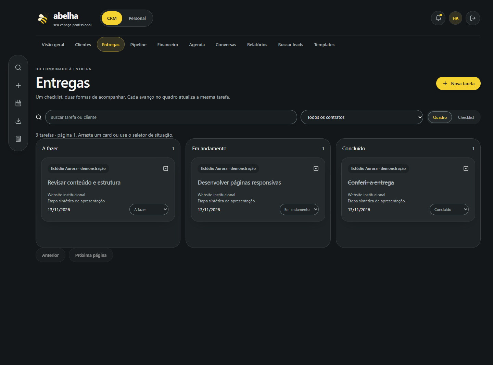
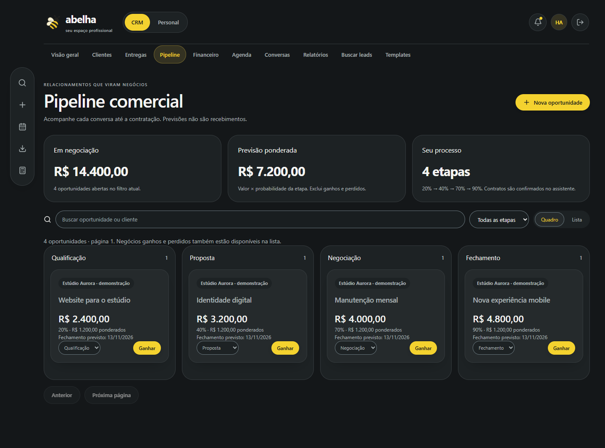
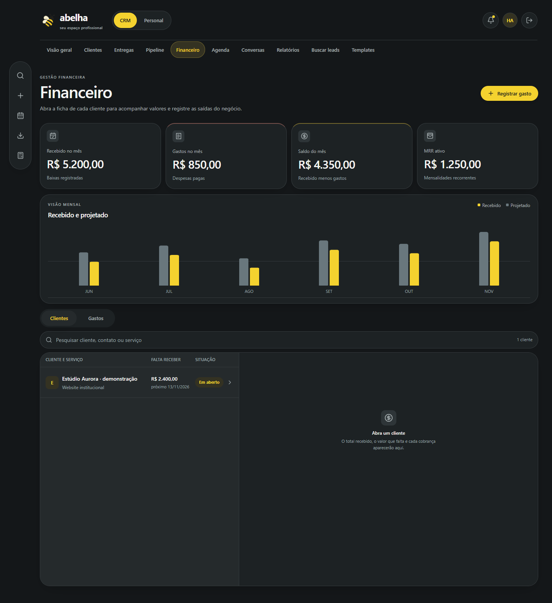
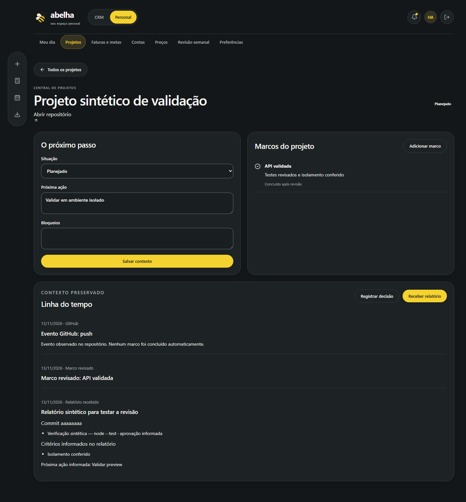
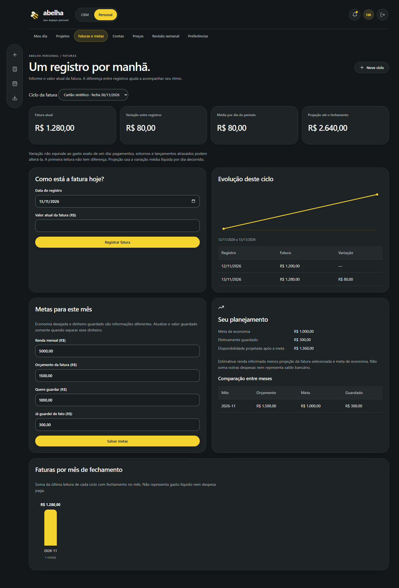
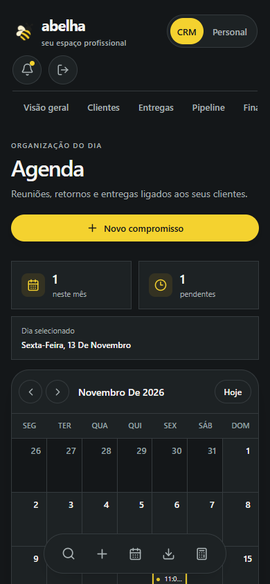
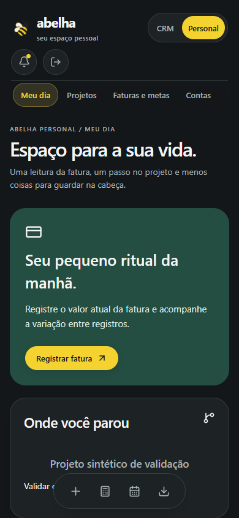
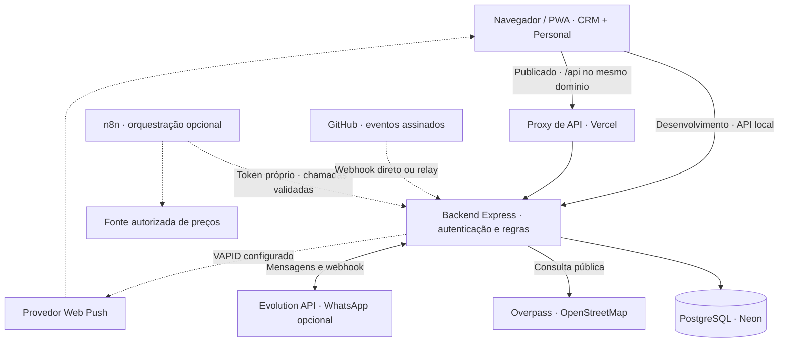

<p align="center">
  
</p>

# Abelha

**Clientes, entregas e vida pessoal em um só lugar.**

O Abelha é uma aplicação web de uso individual que reúne CRM e organização pessoal. No ambiente **CRM**, você acompanha contatos, negociações, contratos, entregas e recebimentos. No **Personal**, organiza projetos, faturas, metas, contas recorrentes e revisões da semana.

A interface compartilha a identidade da abelha, o amarelo e o tema escuro, com navegação adaptada para desktop e celular. Os registros são persistidos em PostgreSQL; frontend e backend ficam em aplicações separadas neste repositório.

[Início rápido](#início-rápido) · [Funcionalidades](#funcionalidades) · [Telas](#telas-do-produto) · [Arquitetura](#arquitetura) · [Documentação](#documentação)



*Interface real compilada, capturada em 13/11/2026 com dados sintéticos. Valores, contatos e projetos das imagens são exemplos de demonstração.*

> **Disponibilidade:** CRM e Personal estão implementados no código. A ativação das tabelas Personal em produção e a operação das integrações têm requisitos próprios. Consulte [ambientes e limites](#ambientes-e-limites) antes de configurar uma instalação.

## Sumário

- [Início rápido](#início-rápido)
- [Funcionalidades](#funcionalidades)
- [Telas do produto](#telas-do-produto)
- [Fluxos de uso](#fluxos-de-uso)
- [Arquitetura](#arquitetura)
- [Configuração](#configuração)
- [Banco de dados](#banco-de-dados)
- [Comandos e verificações](#comandos-e-verificações)
- [Ambientes e limites](#ambientes-e-limites)
- [Solução de problemas](#solução-de-problemas)
- [Documentação](#documentação)
- [Licença](#licença)

## Início rápido

### Pré-requisitos

- Node.js **22.12 ou superior** e npm.
- Um banco PostgreSQL acessível por SSL, com a estrutura correspondente aos módulos utilizados. A persistência configurada no projeto é Neon.
- Organização e usuário previamente cadastrados para usar os dados da aplicação. O desenvolvimento local não cria identidades automaticamente.

Os comandos abaixo usam **PowerShell** e partem da raiz do repositório. Frontend e backend têm dependências e lockfiles próprios; não há um comando npm na raiz.

### 1. Preparar as aplicações

Backend:

```powershell
cd backend
npm ci
if (-not (Test-Path .env)) { Copy-Item .env.example .env }
```

Edite `backend/.env` com a conexão do ambiente pretendido, `AUTH_SECRET`, `AUTH_URL` e `FRONTEND_URL`. Consulte a [tabela de variáveis](#variáveis-de-ambiente). As integrações opcionais podem permanecer sem configuração enquanto não forem utilizadas.

Em outro terminal, a partir da raiz:

```powershell
cd frontend
npm ci
if (-not (Test-Path .env.local)) { Copy-Item .env.local.example .env.local }
```

Para o desenvolvimento padrão, `frontend/.env.local` deve conter:

```dotenv
VITE_API_URL=http://localhost:3000
```

### 2. Iniciar backend e frontend

No terminal do backend:

```powershell
npm run dev
```

No terminal do frontend:

```powershell
npm run dev
```

| Aplicação | Endereço padrão | Como conferir |
|---|---|---|
| Frontend Vite | `http://localhost:5173` | Abrir a interface e consultar um módulo com banco configurado. |
| Backend Express | `http://127.0.0.1:3000` | `GET /health` retorna `{"status":"ok"}`. |

O endpoint `/health` confirma que o processo responde; ele não testa conexão, schema ou integrações. Se o Vite escolher outra porta, ajuste `FRONTEND_URL` para a origem exibida no terminal. Ao terminar, encerre os dois processos com `Ctrl+C`.

### 3. Entender o acesso local

No Vite em desenvolvimento, acessado por `localhost` ou loopback, a interface abre diretamente. O backend fora de produção também reconhece acesso direto da própria máquina, sem proxy ou headers de encaminhamento, e exige **uma única organização existente**. O Personal exige ainda um usuário identificável nessa carteira.

Esse modo continua usando o PostgreSQL configurado em `DATABASE_URL`: salvar na interface pode gravar no banco remoto. Para explorar sem uma carteira real, use a [prévia sintética](#prévia-isolada-sem-banco-remoto). Acesso remoto, proxy e produção exigem sessão autenticada.

## Funcionalidades

### CRM — operação profissional

| Área | O que permite fazer |
|---|---|
| **Visão geral** | Acompanhar carteira, novos contatos, recebimentos registrados e próximos compromissos. |
| **Clientes** | Cadastrar contatos, consultar contratos, manter notas de relacionamento e definir a próxima ação. |
| **Contratos e catálogo** | Selecionar serviços, revisar valores e datas, configurar parcelamento e mensalidades e gerar cobranças. |
| **Entregas** | Organizar tarefas em quadro ou checklist, com vínculo a cliente/contrato e prazo. |
| **Pipeline** | Acompanhar oportunidades por etapa, valor e probabilidade; confirmar a contratação por um assistente. |
| **Financeiro** | Consultar cobranças, dar baixa ou reabrir recebimentos, registrar gastos, acompanhar MRR e imprimir o extrato do cliente. |
| **Agenda** | Organizar compromissos e retornos relacionados aos contatos. |
| **Conversas** | Consultar atendimento e trocar mensagens pelo canal WhatsApp quando a Evolution API estiver conectada; receber eventos por SSE. |
| **Relatórios** | Consultar resultados e previsões do período, mantendo a distinção entre oportunidade e receita recebida. |
| **Buscar leads** | Consultar dados públicos do OpenStreetMap por nicho/cidade e revisar os contatos antes da importação. |
| **Templates** | Gerar e editar propostas e checklists de serviços, sem criar contrato ou cobrança nessa etapa. |
| **Ações globais** | Buscar clientes, oportunidades e tarefas; consultar avisos internos; exportar registros comerciais em CSV/JSON e acessar a calculadora externa de preços. |

### Personal — organização pessoal

| Área | O que permite fazer |
|---|---|
| **Meu dia** | Retomar projetos e próximas ações, consultar avisos e acessar o registro da fatura. |
| **Projetos** | Guardar contexto, repositório, decisões, bloqueios, marcos e relatórios com evidências; concluir marcos após revisão explícita. |
| **Faturas e metas** | Criar ciclos, registrar o valor atual da fatura, comparar leituras, consultar projeções e acompanhar renda, orçamento e economia. |
| **Contas** | Cadastrar recorrências, acompanhar vencimentos e registrar manualmente pagamentos confirmados. |
| **Preços** | Cadastrar produtos e preços-alvo; receber observações e alertas quando houver uma fonte autorizada conectada. |
| **Revisão semanal** | Gerar uma revisão a partir dos registros pessoais, com projetos, próximos passos e pendências. |
| **Preferências** | Configurar horários e ativar notificações no dispositivo quando o backend estiver preparado para Web Push. |

### Regras que orientam os resultados

- **Negociação não é recebimento.** Mover uma oportunidade para ganha exige revisar e confirmar o contrato. A previsão ponderada considera a probabilidade da etapa.
- **O contrato define as cobranças.** Há pagamento à vista com 5% de desconto sobre o serviço, parcelamento em 2x e opção em 3x vinculada à mensalidade. O cálculo preserva centavos e ajusta vencimentos ao calendário. Contratos com cobranças pagas têm a estrutura financeira protegida na edição.
- **Variação da fatura não é gasto exato do dia.** Pagamentos, estornos e lançamentos tardios podem mudar a diferença entre leituras. Meta de economia e dinheiro efetivamente guardado são registros distintos.
- **Confirmar uma conta registra o pagamento informado.** O Abelha não realiza transferências nem pagamentos bancários.
- **Relatório recebido não conclui um marco.** As evidências e os critérios de aceite precisam ser revisados antes da confirmação.
- **Fontes externas têm estado explícito.** A ausência de provedor de preços aparece como configuração pendente; falhas de busca pública retornam erro, sem resultados ou cotações fabricados.

## Telas do produto

As nove capturas deste README foram produzidas na prévia local isolada, em Chrome, com o frontend compilado. As telas comerciais usam fixtures de apresentação; os registros Personal foram criados e consultados no PostgreSQL efêmero da prévia. Não são evidência de envio WhatsApp, push físico ou execução do motor n8n.

### Personal — meu dia

Retome o próximo passo dos projetos e acesse faturas, contas e revisão semanal.



<details>
<summary><strong>CRM: entregas, pipeline e financeiro</strong></summary>

**Entregas:** tarefas distribuídas em colunas, com cliente, serviço e prazo.



**Pipeline:** negociações por etapa e previsão ponderada, com confirmação assistida do contrato.



**Financeiro:** consulta da carteira, indicadores e acesso ao detalhamento das cobranças.



</details>

<details>
<summary><strong>Personal: projeto com revisão e acompanhamento da fatura</strong></summary>

**Projetos:** contexto, próxima ação, marcos e linha do tempo. O exemplo registra o recebimento do relatório e a revisão que concluiu o marco.



**Faturas e metas:** leituras do ciclo, variação entre registros, projeção e planejamento mensal.



</details>

<details>
<summary><strong>Celular: agenda e Personal</strong></summary>

Capturas em viewport de **390 × 844 px**. A navegação horizontal mantém as áreas acessíveis e a barra inferior reúne as ações rápidas.

<p>
  
  
</p>

</details>

O sistema visual, os estados de interface e as verificações anteriores estão detalhados em [DESIGN.md](DESIGN.md), [UX-CONTRACT.md](UX-CONTRACT.md) e [DARK-MODE.md](docs/DARK-MODE.md).

## Fluxos de uso

### Do contato ao recebimento

Exemplo de operação comercial baseado nas telas, rotas e regras implementadas:

1. Cadastre um contato em **Clientes** ou revise um candidato de **Buscar leads**.
2. Abra uma oportunidade em **Pipeline**, informando serviço, valor e fechamento previsto.
3. Ao concluir a negociação, use **Confirmar como ganho** e revise serviço, datas, forma de pagamento e mensalidade no assistente.
4. Confirme o contrato para vincular a contratação e gerar as cobranças correspondentes.
5. Organize a execução em **Entregas** e registre compromissos e próximas ações.
6. Em **Financeiro**, confira o extrato e registre a baixa quando o recebimento ocorrer.

O frontend conduz a operação; o backend valida o contrato, aplica as regras e persiste os registros no escopo da organização. O recebimento entra nos indicadores pela baixa registrada, enquanto oportunidades abertas continuam como previsão. As imagens comerciais ilustram o fluxo com fixtures; este roteiro não representa uma contratação executada na carteira real.

### Do projeto ao marco revisado

**Objetivo:** retomar um projeto com contexto e registrar uma etapa concluída somente depois de conferir evidências.

**Pré-requisitos:** acesso ao Personal, usuário identificado e tabelas do módulo disponíveis. O fluxo abaixo foi executado no navegador contra a prévia sintética com PGlite:

1. Em **Personal → Projetos → Novo projeto**, cadastre nome, repositório opcional e próxima ação.
2. Abra o projeto e adicione um marco com título e critérios de aceite.
3. Use **Receber relatório** para registrar um relatório JSON v1 com resumo, commit, testes, referências de evidência e próximos passos.
4. Confira a linha do tempo. O relatório permanece registrado sem concluir automaticamente o marco.
5. Revise as evidências, selecione o marco e confirme que conferiu commit, testes e critérios antes de concluir.
6. Gere a **Revisão semanal** para consultar o contexto junto aos demais registros pessoais.

**Resultado observado:** projeto, relatório e revisão foram persistidos no banco efêmero; o marco passou a **Concluído após revisão** apenas após a confirmação. A captura do projeto acima mostra esse resultado com evidências sintéticas de teste. O formato do relatório está em [development-report.schema.json](docs/integrations/development-report.schema.json).

## Arquitetura



As conexões opcionais representam contratos implementados, sujeitos à configuração e aos limites de ativação de cada ambiente.

### Aplicações e ferramentas

| Componente | Localização | Responsabilidade e dependências |
|---|---|---|
| **Frontend** | `frontend/` | React 19, React Router e TypeScript 6; Vite 8 compila a SPA. Tailwind CSS 4, CSS próprio, Radix e Lucide compõem a interface; Zustand mantém estado de autenticação. Recebe ações do usuário e consulta a API. |
| **Backend** | `backend/` | Node.js, Express 4 e TypeScript 5; concentra autenticação Auth.js, validações, regras comerciais, APIs Personal e integrações. Acessa PostgreSQL por postgres.js e entrega eventos de conversas por SSE. |
| **Persistência** | `backend/src/db/` | PostgreSQL no Neon armazena dados comerciais e pessoais. Migrations evoluem o schema; filtros de organização e, no Personal, de usuário delimitam o acesso. |
| **PWA** | `frontend/pwa/` e `frontend/public/` | Manifesto e service worker permitem instalação e cache do shell estático compilado. Não armazenam respostas privadas de API nem enfileiram gravações offline. |
| **Proxy publicado** | `frontend/api/` e `frontend/vercel.json` | Encaminha autenticação e API ao backend no mesmo domínio do frontend, preservando cookies. Usa `BACKEND_URL` no servidor. |
| **Automações** | `docs/integrations/n8n/` | n8n orquestra captura, busca, lembretes, projetos, contas, preços e revisão; o backend continua responsável por autorizar e persistir. O consolidado é `abelha-automations.json`. |
| **GitHub** | Rotas de integração no backend | Eventos com HMAC alimentam o histórico de projetos. Um evento de repositório não substitui o relatório com evidências nem a revisão do marco. |
| **WhatsApp** | `evolution/` e serviços no backend | Evolution API integra o canal de atendimento. Dockerfile e configuração Fly.io são artefatos de hospedagem dessa integração; não são pré-requisitos para executar os módulos independentes do CRM. |
| **Busca pública** | `backend/src/services/leads.ts` | Consulta Overpass/OpenStreetMap; valida nicho, cidade e limite, preserva origem e exige revisão para importar contatos. |
| **Web Push** | Backend, service worker e preferências | `web-push` usa VAPID para avisos por aparelho. Exige ativação explícita do dispositivo e configuração do servidor. |
| **Testes isolados** | Scripts e testes nos dois projetos | Node Test Runner verifica regras e contratos. PGlite fornece PostgreSQL efêmero; Playwright/Chrome exercitam a interface nos runners visuais. PGlite não substitui o banco da aplicação. |

### Organização do repositório

```text
ABELHA/
├── frontend/
│   ├── src/                 # páginas CRM/Personal, componentes, hooks e API
│   ├── api/                 # proxy server-side publicado na Vercel
│   ├── pwa/                 # service worker e regras de cache
│   ├── public/              # identidade visual, ícones e manifesto
│   └── scripts/             # verificações funcionais e visuais
├── backend/
│   ├── src/routes/          # endpoints por domínio
│   ├── src/services/        # regras, integrações e testes
│   ├── src/middleware/      # sessão e isolamento da carteira
│   ├── src/db/              # conexão, migrations e bootstrap restrito
│   └── scripts/             # runners isolados, prévia e geradores
├── evolution/               # artefatos da integração WhatsApp
├── docs/                    # operação, arquitetura, auditorias e integrações
│   └── images/              # capturas utilizadas neste README
├── DESIGN.md                # identidade e tokens visuais
├── UX-CONTRACT.md           # comportamentos e critérios de interface
└── LICENSE                  # GNU AGPLv3
```

### Superfície da API

| Prefixo | Finalidade |
|---|---|
| `/health` | Resposta de saúde do processo. |
| `/api/auth/*` | Login, sessão, CSRF e logout do Auth.js. |
| `/api/v1/clients`, `/catalog`, `/contracts`, `/finance`, `/reminders` | Rotas comerciais; os prefixos abreviados também ficam sob `/api/v1`. |
| `/api/v1/crm` | Visão geral, tarefas, oportunidades, relacionamento, busca, avisos, relatórios e exportação. |
| `/api/v1/personal` | Projetos, relatórios, marcos, faturas, metas, contas, preços, preferências, avisos e inscrições push. |
| `/api/v1/prospecting` | Busca pública, candidatos, importação, templates e rascunhos. |
| `/api/v1/conversations`, `/api/v1/messages`, `/api/events` | Conversas, envio de mensagens e stream SSE. |
| `/api/v1/integrations` | Entradas autenticadas para automações e webhook GitHub assinado. |
| `/webhooks/evolution` | Recebimento dos eventos da Evolution API. |

As rotas de negócio exigem o acesso correspondente ao ambiente. As mutações dos routers Personal e prospecção também verificam `X-Abelha-Client: web`, enviado pelo cliente da aplicação. Esse header não substitui a autenticação. Contratos e exemplos de automação estão em [INTEGRACOES-N8N.md](docs/INTEGRACOES-N8N.md).

## Configuração

### Variáveis de ambiente

Use [backend/.env.example](backend/.env.example) e [frontend/.env.local.example](frontend/.env.local.example) como referência. Os valores reais ficam fora do Git.

| Variável | Onde configurar | Quando e para que é usada |
|---|---|---|
| `DATABASE_URL` | Backend | Conexão PostgreSQL do ambiente. Necessária para iniciar o backend; o cliente exige SSL. |
| `AUTH_SECRET` | Backend | Segredo da sessão Auth.js. Configure para autenticação e preserve o valor nas atualizações do mesmo ambiente. |
| `AUTH_URL` | Backend | URL de autenticação do backend; exemplo local: `http://localhost:3000`. |
| `FRONTEND_URL` | Backend | Origem permitida no CORS; exemplo local: `http://localhost:5173`. |
| `NODE_ENV` | Backend | `development` no desenvolvimento; `production` exige sessão e usa cookies seguros. |
| `PORT` | Backend | Porta HTTP; padrão `3000`. Fora de produção, o listener fica em `127.0.0.1`. |
| `VITE_API_URL` | Frontend, `.env.local` | URL da API **somente em desenvolvimento**. Builds publicados usam `/api` na própria origem. |
| `BACKEND_URL` | Servidor Vercel | Destino do proxy de API. Em Preview, deve ser HTTPS explícito e diferente do hostname de produção conhecido. Não é uma variável `VITE_*`. |
| `EVOLUTION_API_URL`, `EVOLUTION_API_KEY`, `EVOLUTION_WEBHOOK_SECRET` | Backend | Conexão e validação do canal WhatsApp, quando utilizado. |
| `VAPID_PUBLIC_KEY`, `VAPID_PRIVATE_KEY`, `VAPID_SUBJECT` | Backend | Conjunto necessário para habilitar Web Push. Sem as três variáveis, o envio permanece desativado. |
| `ABELHA_INTEGRATION_TOKEN` | Backend e credencial n8n | Token exclusivo das chamadas de integração, com pelo menos 32 caracteres aleatórios. |
| `ABELHA_INTEGRATION_ORGANIZATION_ID`, `ABELHA_INTEGRATION_USER_ID` | Backend | Fixam a conta autorizada para a integração; a identidade não é escolhida pelo payload. |
| `GITHUB_WEBHOOK_SECRET` | Backend e configuração do webhook | Valida a assinatura HMAC do corpo original dos eventos GitHub. |
| `PRICE_ALLOWED_HOSTS` | Backend | Lista de hosts exatos de produtos autorizados. A allowlist não cria uma fonte de cotação. |

Para gerar um par VAPID, execute `node scripts/generate-vapid.cjs` dentro de `backend/`. O comando imprime chaves novas: armazene-as no ambiente do servidor e preserve o par entre builds. Nunca coloque segredos de backend em variáveis `VITE_*`.

### PWA e notificações

O build gera o service worker a partir de `frontend/pwa/sw.js`. O cache é limitado ao shell e aos recursos estáticos previstos no build. APIs, sessão, SSE e dados privados ficam fora do Cache Storage; consultar ou gravar dados depende de conexão. Uma versão nova só é ativada após a ação de atualização na interface.

Web Push exige as chaves VAPID e a ativação pelo usuário em cada dispositivo. Os avisos usam conteúdo discreto, sem nomes ou valores financeiros no payload exibido. A entrega física ainda precisa ser validada nos aparelhos e ambientes pretendidos. Instruções de instalação e limites: [GUIA-PWA.md](docs/GUIA-PWA.md).

### Automações e integrações opcionais

O workflow consolidado n8n reúne captura de leads, busca pública, lembretes financeiros, contas, preços, projetos e revisão semanal, com tratamento de erros por ramo. Um relógio compartilhado chama o backend, que aplica horários, validações e deduplicação. As entradas de captura e busca não criam clientes sem revisão.

A captura usa regras explícitas; não há LLM conectado para classificar mensagens. Templates de serviços relacionados a IA são modelos de proposta. O monitor de preços precisa de uma API/fonte autorizada e de seu mapeamento real no n8n. GitHub usa assinatura própria, sem reutilizar o token de integração como autenticação do webhook.

Consulte a [definição do workflow único](docs/WORKFLOW-UNICO-N8N.md) e a [situação mais recente em homologação](docs/N8N-HOMOLOGACAO.md) antes de configurar ou ativar gatilhos.

## Banco de dados

**As migrations não rodam automaticamente ao iniciar a aplicação.** O repositório contém evoluções para catálogo, contratos/cobranças, despesas, reformulação do CRM e plataforma Personal.

| Arquivo ou diretório | Uso |
|---|---|
| `backend/src/db/migrations/` | Migrations incrementais a revisar conforme o schema de destino. A plataforma Personal é introduzida em `20261111_personal_platform.sql`. |
| `backend/src/db/homologation/bootstrap-empty.sql` | Bootstrap restrito ao banco vazio `abelha_homologacao`; possui guardas de nome, schema e ausência de estruturas. Não é instalador genérico de produção. |
| `backend/src/db/schema.sql` | **Reset destrutivo legado**, com `DROP TABLE`. Não usar para instalação ou atualização de uma carteira existente. |
| `backend/src/db/seed.ts` | Inserção de organização e usuário com valores fixos no código. Não é necessária para testes locais e não deve ser executada automaticamente. |

Para uma base existente, compare o schema e aplique somente as migrations necessárias, após revisar o ambiente, backup e autorização. Para uma instalação nova, prepare uma base isolada e revise o DDL e a criação da identidade antes de usar a aplicação. Copiar os arquivos `.env` não inicializa o banco.

O isolamento de aplicação usa organização e, no Personal, usuário, com validações e FKs compostas nas tabelas correspondentes. Não há RLS para transformar acesso SQL externo em acesso isolado por usuário; preserve as credenciais de banco no servidor.

Procedimentos: [configuração e ativação](docs/GUIA-CONFIGURACAO.md), [banco da reformulação](docs/BANCO-REFORMULACAO.md) e [checklist de ativação](docs/CHECKLIST-ATIVACAO.md).

## Comandos e verificações

Execute cada comando dentro do diretório indicado.

| Diretório | Comando | Resultado |
|---|---|---|
| `backend/` | `npm run dev` | Backend com recarga por nodemon/ts-node. |
| `backend/` | `npm run build` | Compilação TypeScript para `dist/`. |
| `backend/` | `npm start` | Executa `dist/app.js`, após o build, com o ambiente configurado. |
| `backend/` | `npm test` | Compila e executa regras, contratos e testes HTTP/SQL isolados. |
| `frontend/` | `npm run dev` | Servidor de desenvolvimento Vite. |
| `frontend/` | `npm test` | Testes de navegação, datas, autenticação, proxy, PWA, push e timeout. |
| `frontend/` | `npm run lint` | Verificação ESLint. |
| `frontend/` | `npm run build` | Verificação TypeScript e build Vite em `dist/`, incluindo service worker. |
| `frontend/` | `npm run preview` | Prévia estática do build; não fornece o backend nem o proxy server-side da Vercel. |
| `frontend/` | `npm run test:visual` | Runner de interface/tema escuro; exige Playwright, navegador e prévia sintética preparados. |

### Prévia isolada sem banco remoto

O runner existente permite exercitar o Personal sem usar `backend/.env` ou Neon. Ele cria um PostgreSQL efêmero em memória com PGlite, sessão sintética e listener restrito à própria máquina. Os endpoints comerciais não implementados nessa prévia retornam erro explícito.

Após instalar as dependências e compilar as duas aplicações:

```powershell
# Na raiz do repositório
node backend/scripts/preview-personal.cjs
```

A prévia abre em `http://127.0.0.1:43170`. Em outro terminal, dentro de `frontend/`, com Playwright e Chrome/Chromium disponíveis:

```powershell
node scripts/verify-personal.cjs
npm run test:visual
```

Playwright não é dependência declarada nos manifests do projeto. Os runners aceitam uma instalação existente via `ABELHA_PLAYWRIGHT_MODULE`, o executável via `ABELHA_BROWSER_EXECUTABLE` e a pasta de saída via `ABELHA_SCREENSHOT_DIR`. Os exemplos de reprodução e pré-requisitos estão em [DARK-MODE.md](docs/DARK-MODE.md#reproduzir-localmente).

Execute o runner Personal antes do visual para preparar os registros. Ao terminar, digite **`stop`** no terminal da prévia e confira `SYNTHETIC_PREVIEW_STOPPED`. O encerramento libera o listener HTTP, o socket PostgreSQL efêmero e os dados em memória.

### Verificação desta documentação

As verificações desta reescrita foram executadas sobre o checkout local baseado em `main/40c179c`, preservando as alterações existentes:

| Data | Verificação | Resultado |
|---|---|---|
| 13/11/2026 | Backend: `npm test` | 53 testes aprovados e build TypeScript concluído. |
| 14/11/2026 | Frontend: `npm test`, `npm run lint`, `npm run build` | 20 testes aprovados, lint e build concluídos, incluindo os testes de autenticação presentes na retomada. |

Em 13/11/2026 também foram executados **11 cenários do runner Personal** no navegador: projeto/revisão, evento GitHub sintético, fatura/metas, conta/pagamento manual, preço sem fonte, revisão semanal, template, rejeição de busca inválida, mobile, offline e atualização PWA.

As **nove capturas novas** foram feitas no frontend compilado, sem exceções JavaScript de página, alertas de erro ou overflow horizontal do documento nas telas capturadas. Essas verificações usam dados sintéticos e não comprovam disponibilidade de produção ou funcionamento das integrações externas. A auditoria visual anterior, sua metodologia e limitações ficam em [DARK-MODE.md](docs/DARK-MODE.md).

## Ambientes e limites

Estado verificado em **16/11/2026**: frontend e backend Production e HML publicados no SHA `94ccaa0`, com validações e limites em [SPRINT-LANCAMENTO-20261116.md](docs/SPRINT-LANCAMENTO-20261116.md).

| Área | Situação documentada e limite |
|---|---|
| **Desenvolvimento local** | Vite e Express separados; acesso direto local com identidade existente. Os dados continuam no banco indicado por `DATABASE_URL`. |
| **Homologação** | Preview Vercel com tema escuro conectado ao Render HML e ao banco `abelha_homologacao`, separado da carteira de produção. Detalhes em [VERCEL-PREVIEW-HOMOLOGACAO.md](docs/VERCEL-PREVIEW-HOMOLOGACAO.md). |
| **Produção** | [Abelha](https://abelha-gestor.vercel.app) publicado em `94ccaa0`, com35 tabelas e leitura autenticada de CRM/Personal/Leads/Templates confirmada. Migration Personal aplicada em16/11; não repetir. Escritas funcionais ensaiadas somente em HML sintética. |
| **Publicação** | Render Production On Commit e Vercel Automatic restaurados. Novos pushes manuais na `main` voltam a acionar produção. HML permanece com Auto-Deploy desligado e Preview fixado em SHA. |
| **n8n** | Workflow único HML/inativo,62 nós, somente tick automático e preços desligados. Oito callbacks completos e operações manuais passaram no motor em16/11. Transição de destinos/credenciais/ativação Production continua não autorizada. |
| **Busca pública** | Depende do Overpass; o último ensaio remoto documentado retornou `503`. Há limite de uma consulta pública por minuto por organização. |
| **Preços** | Cadastro disponível; fonte/API e allowlist autorizadas ainda são necessárias. Sem provedor, não há cotação automática. |
| **PWA** | Sete recursos públicos Production e shell offline em VM verificados. Instalação física ainda não certificada. Preview protegido pode impedir precache; health da mesma origem preserva sua sessão de proteção, sem remover SSO. |
| **Push** | Lógica local coberta; entrega e instalação em aparelhos físicos continuam pendentes. |
| **WhatsApp** | Código de integração preservado; exige Evolution API e instância conectada. Esta documentação não atesta envio ou recebimento real. |

Frontend publicado usa o build de `frontend/`; backend usa o build e o comando de início de `backend/`. A configuração do proxy, cookies, destinos de homologação e banco precisa ser revisada para o ambiente antes de qualquer publicação. Veja os guias de [Render HML](docs/RENDER-HOMOLOGACAO.md) e [Preview Vercel](docs/VERCEL-PREVIEW-HOMOLOGACAO.md).

## Solução de problemas

| Sintoma | O que conferir |
|---|---|
| A interface abre, mas os dados falham | Disponibilidade do banco, `DATABASE_URL`, SSL e migrations do ambiente. `/health` sozinho não verifica esses itens. |
| Erro de carteira ou usuário local não identificado | O acesso direto exige uma organização existente; o Personal precisa resolver um usuário único. O sistema não escolhe uma carteira ambígua nem cria cadastro automaticamente. |
| `401` ao acessar a API remotamente | Sessão Auth.js, cookies e origem. A exceção de acesso local não vale para proxy, acesso remoto ou produção. |
| Personal retorna `503` sobre atualização do banco | Verifique as tabelas da migration Personal e o procedimento autorizado de ativação. Não execute o reset legado. |
| API falha no desenvolvimento | Confira o endereço real do backend, `VITE_API_URL`, `FRONTEND_URL` e a porta escolhida pelo Vite. |
| Preview retorna backend de homologação não configurado | Configure `BACKEND_URL` no servidor, no escopo Preview, com HTTPS e backend isolado. `VITE_API_URL` não configura esse proxy. |
| Busca pública falha ou retorna `429` | Aguarde um minuto e verifique o erro de Overpass exibido. Falha ou timeout não significa ausência de empresas. |
| Preços mostram “Aguardando fonte” | Falta uma fonte autorizada configurada; apenas cadastrar o produto ou preencher a allowlist não fornece cotações. |
| Push está desativado | Confira as três variáveis VAPID, a permissão e a inscrição do aparelho. Após troca de chaves, reative no dispositivo. |
| `npm run preview` não acessa dados | A prévia Vite serve arquivos estáticos. O build espera `/api` na mesma origem, atendida por um backend/proxy; para ensaio isolado, use o runner sintético. |

## Documentação

| Assunto | Referências |
|---|---|
| Produto e escopo | [Escopo da reformulação](docs/escopo-implementacao.md) · [Roadmap](docs/ROADMAP-ABELHA.md) |
| Arquitetura e dados | [CRM + Personal](docs/ARQUITETURA-PERSONAL.md) · [Banco da reformulação](docs/BANCO-REFORMULACAO.md) |
| Identidade e experiência | [Design](DESIGN.md) · [Contrato de UX](UX-CONTRACT.md) · [Tema escuro e capturas](docs/DARK-MODE.md) |
| Execução e ativação | [Configuração](docs/GUIA-CONFIGURACAO.md) · [Checklist](docs/CHECKLIST-ATIVACAO.md) · [PWA](docs/GUIA-PWA.md) |
| Integrações | [Contratos n8n](docs/INTEGRACOES-N8N.md) · [Workflow único](docs/WORKFLOW-UNICO-N8N.md) · [Ensaio n8n HML](docs/N8N-HOMOLOGACAO.md) |
| Homologação | [Integração e isolamento](docs/HOMOLOGACAO-INTEGRACAO.md) · [Render](docs/RENDER-HOMOLOGACAO.md) · [Vercel Preview](docs/VERCEL-PREVIEW-HOMOLOGACAO.md) |
| Evidências e pendências | [Progresso](docs/PROGRESSO.md) · [Auditoria de ativação](docs/AUDITORIA-ATIVACAO.md) · [Relatórios estruturados](docs/audits/) |

Os documentos de progresso e operação preservam registros históricos. Ao comparar estados, consulte a atualização mais recente e confira o código e a configuração do ambiente correspondente.

## Licença

Distribuído sob a **GNU Affero General Public License, versão 3 (AGPLv3)**. Consulte o texto integral em [LICENSE](LICENSE).
