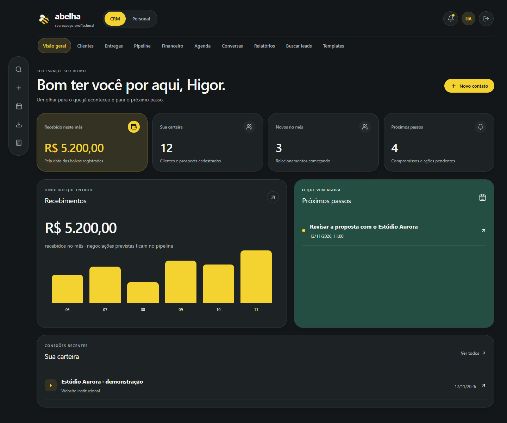
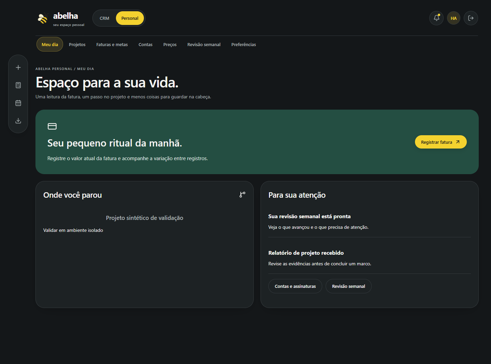
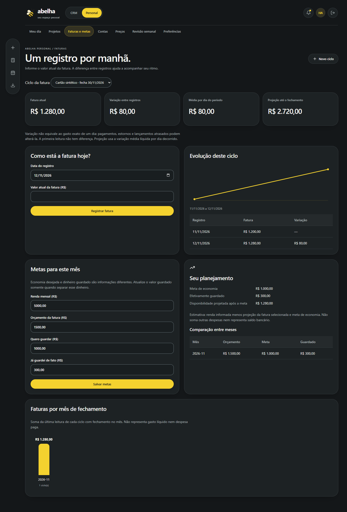
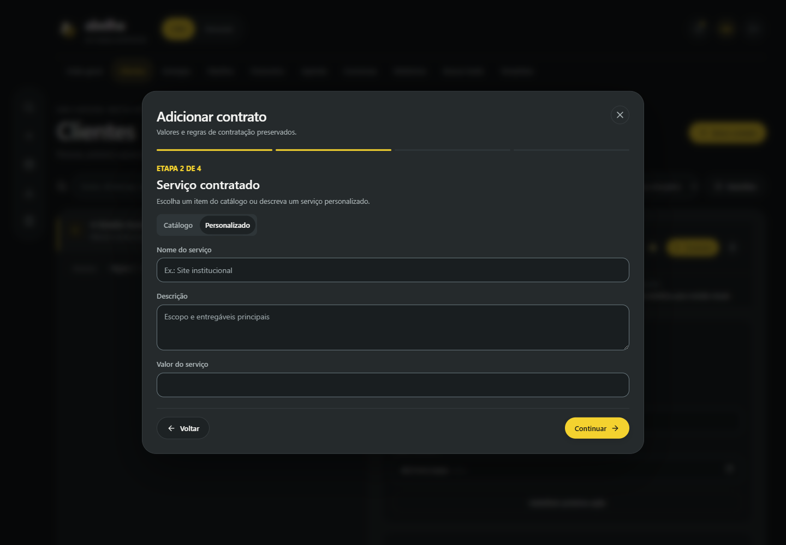
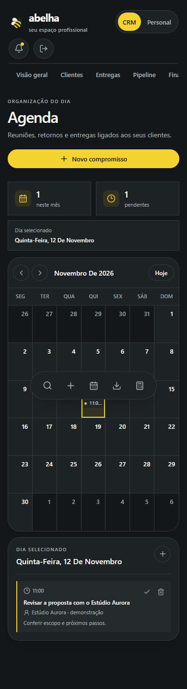
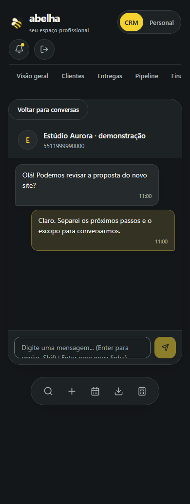

# Abelha — Dark Mode

Direção visual de 12/11/2026, sobre `main/4f78117`. Tema escuro padrão para CRM, Personal e login; composição e funcionalidades preservadas. [Contrato visual e tokens](../DESIGN.md).

## Sistema visual

O fundo `#141719`, os painéis `#1D2224` e os cards `#252A2C` criam profundidade por superfície, sem gradientes decorativos. Bordas `#353B3E` delimitam grupos. Campos têm borda mais forte para identificação e foco amarelo visível. Texto principal `#F5F5F3` e secundário `#AAB3B5` mantêm a leitura; amarelo `#F4D22F` continua nas ações, gráficos, seleção e progresso. Verde `#244E42` fica nos painéis contextuais de próximos passos e ritual da fatura.

`frontend/src/theme.css` mantém a única paleta; `index.css`, `workspace.css`, `personal.css` e os adaptadores Tailwind consomem seus papéis semânticos. Conversas usam classes compartilhadas em vez de cores inline. Controles nativos seguem `color-scheme:dark`, respeitando os popups do navegador/sistema. O extrato usa tema escuro na tela e papel claro somente na impressão.

## Capturas

Todas as imagens abaixo são da aplicação real compilada em Chrome, com dados exclusivamente sintéticos. Não representam clientes, saldos ou integrações da carteira.

### CRM — visão geral

### Personal — meu dia

### Personal — faturas e metas

### Formulário de contrato

### Celular — agenda e conversas

| Agenda | Conversas |
|---|---|
|  |  |

## Matriz de telas

Desktop: **1440 × 1000**. Mobile: **390 × 844**. Reflow adicional das 17 áreas em **320px e 768px**. Conferência visual por capturas, contraste de texto por cores computadas/composição alpha e checagem de overflow no documento.

| Área | Tela / view | Desktop | Mobile |
|---|---|---|---|
| CRM | Visão geral / `overview` | Conferido | Conferido |
| CRM | Clientes / `clients` | Conferido | Conferido |
| CRM | Entregas / `deliveries` | Conferido | Conferido |
| CRM | Pipeline / `pipeline` | Conferido | Conferido |
| CRM | Financeiro / `finance` | Conferido | Conferido |
| CRM | Agenda / `agenda` | Conferido | Conferido |
| CRM | Conversas / `inbox` | Conferido | Conferido |
| CRM | Relatórios / `reports` | Conferido | Conferido |
| CRM | Buscar leads / `leads` | Conferido | Conferido |
| CRM | Templates / `templates` | Conferido | Conferido |
| Personal | Meu dia / `personal-overview` | Conferido | Conferido |
| Personal | Projetos / `personal-projects` | Conferido | Conferido |
| Personal | Faturas e metas / `personal-finance` | Conferido | Conferido |
| Personal | Contas / `personal-subscriptions` | Conferido | Conferido |
| Personal | Preços / `personal-prices` | Conferido | Conferido |
| Personal | Revisão semanal / `personal-review` | Conferido | Conferido |
| Personal | Preferências / `personal-settings` | Conferido | Conferido |
| Acesso | Login / `/login` | Conferido | Conferido |

Também conferidos: detalhes do cliente, financeiro e projeto; mensagens recebidas/enviadas; formulários de contato, contrato, tarefa, oportunidade, compromisso, gasto, projeto, ciclo, conta e acompanhamento de preço; busca, exportações e avisos dos dois ambientes; extrato na tela e em impressão; seleção nativa, teclado e foco; carregamento, vazio, erro e recuperação.

## Verificações

- TypeScript (`tsc -b`), ESLint com zero warnings e build Vite aprovados. Os executáveis locais foram usados diretamente porque `npm` não estava disponível no PATH desta sessão; manifests de dependências e lockfiles foram preservados.
- **16 testes frontend** e **53 testes backend** aprovados. Os testes de backend usam o runner sintético existente; nenhuma alteração foi feita no backend ou em seu banco.
- **11 cenários funcionais Chrome** do runner Personal existente aprovados: projetos/revisão, GitHub sintético, faturas/metas, contas/pagamento, ausência de preço inventado, revisão semanal, templates, validação de leads, mobile, offline e atualização PWA preservando rascunho.
- **79 capturas** do novo runner visual aprovadas: zero erros JavaScript de página, fundos claros residuais, overflow do documento ou falhas no contraste de texto medido. Todos os botões inspecionados têm nome acessível. Modais verificam foco preso, Escape e retorno ao botão de abertura.
- Manifesto, metadados e cor computada do documento coerentes com o tema escuro; o tema permanece escuro mesmo com preferência de sistema clara. Scrollbars preservam comportamento de sistema em forced-colors. Movimento reduzido respeitado.
- CSS analisado com PostCSS sem erros de sintaxe/variáveis indefinidas. Os **830 seletores históricos** de `index.css` foram preservados; a migração alterou cores, tipografia e os ajustes de acessibilidade documentados.
- Revisão final corrigiu foco de baixo contraste, cabeçalho do extrato na impressão e largura mínima do toolbar do calendário. Também foram corrigidos progresso nativo verde, sobreposição da composição de mensagens, largura de select em 320px e quebra da quarta coluna do pipeline no celular.

Evidência detalhada: [resultado do navegador](audits/dark-mode-browser-20261112.json) e [auditoria estática](audits/dark-mode-premium-20261112.json).

### Limites da auditoria

A auditoria estática estrita continua retornando código 1 por **39 divergências conhecidas do contrato existente**: 24 formulários com validação nativa e 15 textareas redimensionáveis, frente à preferência genérica da ferramenta por `noValidate` e `resize:none`. A base tinha 40 apontamentos; o textarea das conversas agora explicita seu comportamento. Conforme [UX-CONTRACT.md](../UX-CONTRACT.md), a validação comercial existente foi preservada. Isso não é uma aprovação integral do auditor estático.

As medições de contraste abrangem o texto renderizado inspecionado; imagens, controles desabilitados e os popups nativos precisam de inspeção visual. Não há certificação completa WCAG nem ensaio em aparelhos físicos/Safari. A prévia não comprova envio WhatsApp/push real ou execução de n8n. Banco, migrations, homologação e integrações remotas permaneceram fora desta alteração visual.

## Reproduzir localmente

1. Compilar frontend e backend com os comandos existentes (`npm run build` em cada diretório).
2. Na raiz: `node backend/scripts/preview-personal.cjs`. Essa prévia usa PGlite efêmero, sessão sintética e somente loopback; não carregar arquivos privados de homologação nem iniciar o backend comercial.
3. Em `frontend`, executar `node scripts/verify-personal.cjs` para preparar e verificar os registros sintéticos; depois `npm run test:visual`.
4. Se necessário, definir `ABELHA_PLAYWRIGHT_MODULE` para uma instalação existente de Playwright, `ABELHA_BROWSER_EXECUTABLE` para Chrome e `ABELHA_SCREENSHOT_DIR` para o diretório de saída. Os runners aceitam somente a prévia em `127.0.0.1`.
5. Enviar `stop` na entrada da prévia e confirmar `SYNTHETIC_PREVIEW_STOPPED`. Conferir a liberação da porta HTTP e do socket efêmero informados no início. Navegadores são fechados pelos runners em `finally`.

Sem commit, push ou deploy nesta entrega. Alterações paralelas de homologação foram preservadas.

Encerramento confirmado: prévias sintéticas finalizaram com `SYNTHETIC_PREVIEW_STOPPED` e saída 0. As portas HTTP `43170` e sockets efêmeros `50567`, `57880` e `58286` foram vinculadas e liberadas novamente em uma checagem local, comprovando ausência de listeners. Os runners fecharam seus contextos e navegadores em `finally`; nenhum servidor desta verificação foi mantido ativo.
